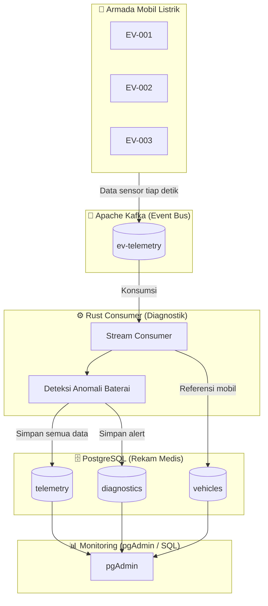

# 🚗⚡ EV Fleet Telemetry & Diagnostik

[](https://github.com/101manparta/ev-fleet-telemetry/actions/workflows/ci.yml)
[](https://www.rust-lang.org/)
[](https://kafka.apache.org/)
[](https://www.postgresql.org/)
[](https://www.terraform.io/)
[](https://www.docker.com/)
[](https://opensource.org/licenses/MIT)

Sistem monitoring dan diagnostik armada mobil listrik (EV) secara **real-time** menggunakan stack **Rust + Apache Kafka + PostgreSQL + Terraform**.

> **Analogi:** Setiap mobil listrik adalah "pasien" yang terus-menerus mengirim detak jantung baterai (telemetri). Apache Kafka adalah "ambulans" yang mengantarkan data. Rust consumer adalah "perawat" yang memeriksa dan mencatat ke rekam medis (PostgreSQL).

---

## 📋 Daftar Isi

- [🎯 Tujuan Proyek](#-tujuan-proyek)
- [🏗️ Arsitektur Sistem](#️-arsitektur-sistem)
- [🛠️ Teknologi yang Digunakan](#️-teknologi-yang-digunakan)
- [🗄️ Desain Database](#️-desain-database)
- [📂 Struktur Folder](#-struktur-folder)
- [⚡ Cara Menjalankan (Lokal & Gratis)](#-cara-menjalankan-lokal-dan-gratis)
- [📊 Contoh Output & Query](#-contoh-output--query)
- [🌍 Deploy ke AWS (Opsional)](#-deploy-ke-aws-opsional)
- [🗺️ Roadmap](#️-roadmap)
- [🤝 Kontribusi](#-kontribusi)
- [📄 Lisensi](#-lisensi)
- [👤 Author](#-author)

---

## 🎯 Tujuan Proyek

| Tujuan | Penjelasan |
|--------|------------|
| 🔍 **Pemantauan Real-time** | Mengetahui posisi dan kondisi baterai ratusan mobil sekaligus. |
| ⚠️ **Deteksi Dini Kerusakan** | Tangkap baterai yang panas berlebih atau daya menurun cepat sebelum mobil macet di jalan. |
| 🔋 **Manajemen Pengisian Daya** | Tahu mobil mana yang baterainya hampir habis agar segera diarahkan ke SPKLU. |
| 💰 **Hemat Biaya Perawatan** | Perbaiki saat masih kecil, bukan menunggu baterai total rusak dan harus diganti. |
| 🛡️ **Keamanan Armada** | Hindari risiko kebakaran baterai atau kehilangan kendaraan karena gangguan teknis. |

---

## 🏗️ Arsitektur Sistem



### Alur Data Singkat

1. **Producer (Rust)** mensimulasikan 3 mobil listrik mengirim data sensor (SoC, suhu, kecepatan) ke Kafka.
2. **Consumer (Rust)** membaca data dari Kafka, menyimpan ke tabel `telemetry`, dan mendeteksi anomali.
3. Jika terdeteksi SoC < 20% atau suhu baterai > 40°C, sistem membuat alert di tabel `diagnostics`.
4. Data dapat dilihat melalui **pgAdmin** atau query SQL.

---

## 🛠️ Teknologi yang Digunakan

| Layer | Teknologi | Fungsi |
|-------|-----------|--------|
| **Bahasa** |  | Producer & Consumer (performa tinggi, aman memori) |
| **Event Streaming** |  | Antrian data real-time yang tahan lama |
| **Database** |  | Penyimpanan data terstruktur & relasional |
| **Infrastructure** |  | Provisioning infra (AWS VPC, EC2, SG) |
| **Container** |  | Menjalankan Kafka & PostgreSQL secara lokal |
| **Serialisasi** | Serde JSON | Format data antar komponen |

---

## 🗄️ Desain Database

Database menggunakan **PostgreSQL** dengan bahasa **SQL**. Tabel utama:

### 1. `vehicles` — Data Master Armada
| Kolom | Tipe | Keterangan |
|-------|------|------------|
| `vehicle_id` | `VARCHAR(50)` | ID unik mobil (PK) |
| `plate_number` | `VARCHAR(20)` | Nomor polisi |
| `model` | `VARCHAR(100)` | Tipe mobil (Tesla Model 3, dll) |
| `battery_capacity_kwh` | `NUMERIC(6,2)` | Kapasitas baterai |
| `status` | `VARCHAR(20)` | active / maintenance / offline |

### 2. `telemetry` — Data Sensor (Banyak Data)
| Kolom | Tipe | Keterangan |
|-------|------|------------|
| `id` | `BIGSERIAL` | ID data (PK) |
| `vehicle_id` | `VARCHAR(50)` | FK ke `vehicles` |
| `timestamp` | `TIMESTAMP` | Waktu data dikirim |
| `soc_percent` | `NUMERIC(5,2)` | State of Charge baterai (%) |
| `battery_temp_c` | `NUMERIC(5,2)` | Suhu baterai (°C) |
| `speed_kmh` | `NUMERIC(6,2)` | Kecepatan (km/jam) |
| `charger_connected` | `BOOLEAN` | Apakah sedang diisikan daya |

### 3. `diagnostics` — Hasil Deteksi Anomali
| Kolom | Tipe | Keterangan |
|-------|------|------------|
| `id` | `BIGSERIAL` | ID alert (PK) |
| `vehicle_id` | `VARCHAR(50)` | FK ke `vehicles` |
| `alert_type` | `VARCHAR(50)` | Jenis masalah (soc_critical, battery_overheat) |
| `severity` | `VARCHAR(20)` | warning / critical |
| `detected_at` | `TIMESTAMP` | Kapan terdeteksi |
| `resolved` | `BOOLEAN` | Sudah ditangani atau belum |

---

## 📂 Struktur Folder

```
ev-fleet-telemetry/
├── .github/
│   └── workflows/
│       └── ci.yml              # GitHub Actions CI untuk Rust
├── docker-compose.yml          # Kafka + PostgreSQL + pgAdmin
├── init-sql/
│   └── 01-schema.sql           # Skema tabel database
├── producer/
│   ├── Cargo.toml
│   └── src/main.rs             # Simulasi mobil kirim data ke Kafka
├── consumer/
│   ├── Cargo.toml
│   └── src/main.rs             # Terima data, deteksi anomali, simpan DB
├── terraform/
│   └── main.tf                 # Infra AWS (opsional, berbayar)
├── .env.example                # Contoh environment variable
├── .gitignore                  # File yang diabaikan Git
└── README.md                   # Dokumentasi ini
```

---

## ⚡ Cara Menjalankan (Lokal & Gratis)

### 1. Persyaratan

Pastikan alat berikut terinstal di laptop kamu:

| Alat | Fungsi | Unduh |
|------|--------|-------|
| **Docker Desktop** | Menjalankan Kafka & PostgreSQL | [docker.com](https://www.docker.com/products/docker-desktop/) |
| **Rust** | Kompilasi producer & consumer | [rustup.rs](https://rustup.rs/) |

> **Windows:** Jika `cargo build` error soal linker (`cc` not found), instal **Visual Studio Build Tools** dengan beban kerja *"Desktop development with C++"*.

### 2. Clone Repository

```powershell
git clone https://github.com/101manparta/ev-fleet-telemetry.git
cd ev-fleet-telemetry
```

### 3. Jalankan Infrastruktur (Docker Compose)

```powershell
docker compose up -d
```

Cek container:
```powershell
docker compose ps
```

Layanan yang akan berjalan:
- 🔴 **Kafka**: `localhost:9092`
- 🗄️ **PostgreSQL**: `localhost:5432` (user: `evadmin`, pass: `evpassword`, db: `ev_fleet`)
- 📊 **pgAdmin (UI)**: `http://localhost:5050` (login: `admin@evfleet.local` / `admin`)

### 4. Jalankan Producer (Simulasi Mobil)

Buka terminal baru:

```powershell
cd producer
cargo run
```

**Contoh output:**
```
🚗 EV Producer started.
   Brokers: localhost:9092
   Topic:   ev-telemetry
   Armada : 3 mobil

📤 EV-001 | SoC: 80.0% | Temp: 35.0°C | Speed: 0.0 km/h | Charger: false
📤 EV-002 | SoC: 80.0% | Temp: 35.0°C | Speed: 0.0 km/h | Charger: false
...
```

### 5. Jalankan Consumer (Diagnostik)

Buka terminal baru lagi:

```powershell
cd consumer
cargo run
```

**Contoh output:**
```
📡 EV Consumer started.
   Brokers: localhost:9092
   Topic:   ev-telemetry
   Database: terhubung

✅ EV-001 | SoC: 79.5% | Temp: 35.5°C | Speed: 2.0 km/h | Charger: false
🚨 ALERT [CRITICAL] EV-001: soc_critical
🚨 ALERT [WARNING] EV-001: battery_warm
```

---

## 📊 Contoh Output & Query

Buka **pgAdmin** di `http://localhost:5050`, tambahkan server:
- Host: `localhost`, Port: `5432`
- Username: `evadmin`, Password: `evpassword`

Query contoh untuk melihat data:

```sql
-- Lihat semua telemetry terbaru
SELECT * FROM telemetry ORDER BY timestamp DESC LIMIT 10;

-- Lihat mobil yang mengalami alert kritis
SELECT vehicle_id, alert_type, severity, detected_at
FROM diagnostics
WHERE severity = 'critical'
ORDER BY detected_at DESC;

-- Lihat riwayat suhu baterai mobil EV-001
SELECT timestamp, battery_temp_c, soc_percent
FROM telemetry
WHERE vehicle_id = 'EV-001'
ORDER BY timestamp DESC;
```

---

## 🌍 Deploy ke AWS (Opsional)

> ⚠️ Resource AWS **berbayar**. Gunakan hanya jika sudah siap mengelola biaya cloud.

Folder `terraform/` menyediakan skrip untuk membuat VPC, subnet, security group, dan EC2 di AWS (region Jakarta).

```powershell
cd terraform
terraform init
terraform plan
terraform apply
```

Kafka (MSK) belum dibuat otomatis dalam file ini untuk mengontrol biaya. Kamu dapat memasang Kafka secara manual di EC2 atau menggunakan AWS MSK terpisah.

---

## 🗺️ Roadmap

| Fase | Fitur | Status |
|------|-------|--------|
| 1 | Producer & Consumer Rust + Kafka + PostgreSQL lokal | ✅ Selesai |
| 2 | Dashboard Web (Axum/Actix) untuk monitoring armada | 🔄 Rencanaan |
| 3 | Notifikasi email/WhatsApp saat alert critical | 🔄 Rencanaan |
| 4 | TimescaleDB untuk data time-series skala besar | 🔄 Rencanaan |
| 5 | Deploy Kafka pakai AWS MSK via Terraform | 🔄 Rencanaan |

---

## 🤝 Kontribusi

Kontribusi sangat diterima! Silakan:

1. Fork repository ini
2. Buat branch fitur (`git checkout -b fitur/nama-fitur`)
3. Commit perubahan (`git commit -m "Tambah fitur X"`)
4. Push ke branch (`git push origin fitur/nama-fitur`)
5. Buat Pull Request

Pastikan kode mengikuti konvensi Rust (`cargo fmt` dan `cargo clippy`).

---

## 📄 Lisensi

Distribusi unter lisensi **MIT**. Lihat file [LICENSE](LICENSE) untuk informasi lebih lanjut.

---

## 👤 Author

Dibuat oleh **[101manparta](https://github.com/101manparta)**  
📧 GitHub: [https://github.com/101manparta](https://github.com/101manparta)

> "Membangun sistem telemetri armada mobil listrik yang terukur, terdeteksi, dan terawat sejak dini." 🚗⚡